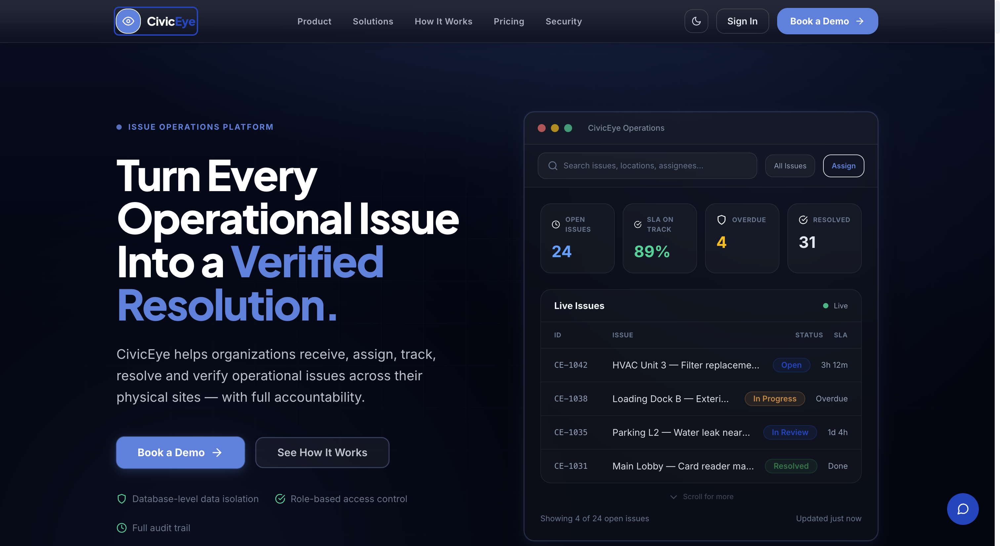
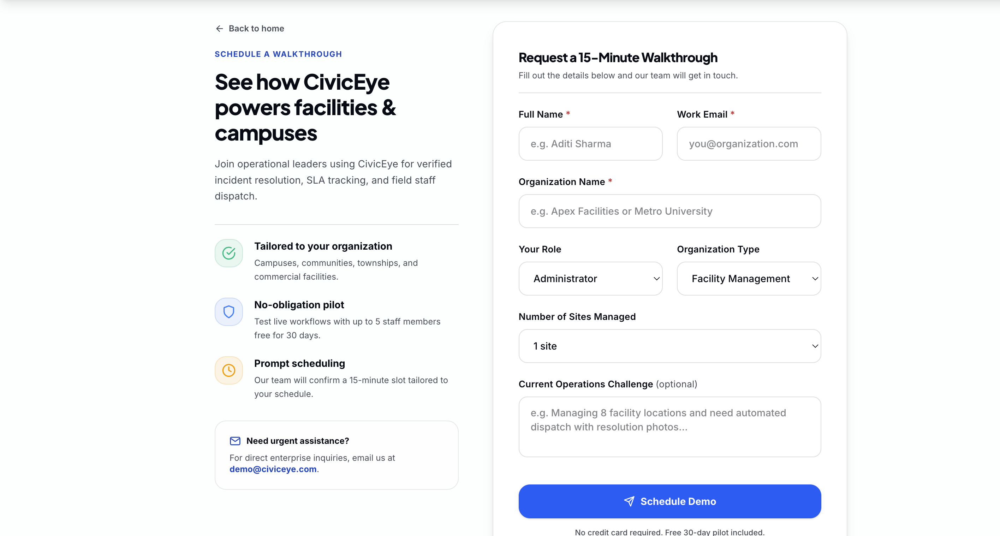
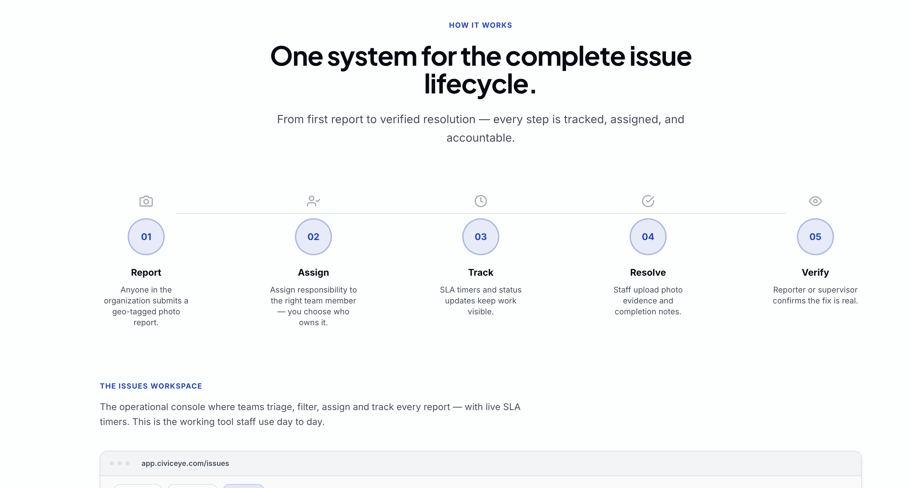
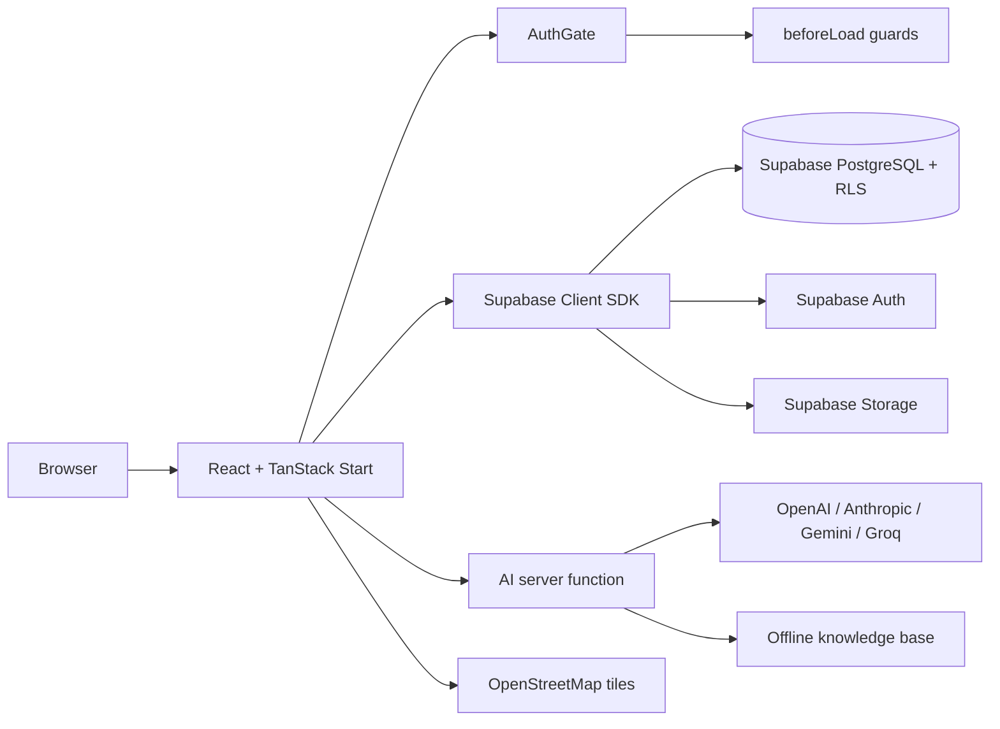

# CivicEye

Multi-tenant civic issue management platform with SLA tracking, evidence-based resolution, organization team management, and an in-product AI assistant. Built with React 19, TanStack Start, Supabase, and Leaflet.

---

## Overview

Municipalities, campus facilities, and property management teams struggle to track civic issues -- potholes, water leaks, broken streetlights -- across distributed teams. Reports get lost, SLAs are missed, and accountability is unclear.

CivicEye solves this with:

- A **citizen-facing reporting flow** where anyone can submit an issue with a photo, GPS location, and category
- A **staff dashboard** where administrators assign, track, and resolve issues with photographic evidence
- **SLA tracking** to ensure issues are addressed within defined response and resolution windows
- **Multi-tenant isolation** so each organization's data stays separate
- **An organization console** where admins invite teammates and manage seats, roles, and billing
- **A CivicEye AI assistant** that answers questions grounded in your own workspace data

**Intended for:** Facility managers, campus administrators, municipal operations teams, and ward-level government staff.

---

## Live Demo

**[https://civic-eye-alpha.vercel.app](https://civic-eye-alpha.vercel.app)**

> The demo is deployed on Vercel. Staff features require a Supabase backend with seeded data. The citizen reporting flow (`/report`) works without authentication.

---

## Screenshots

### Landing Page



### Login



### Citizen Report Form



---

## Core Features

### Authentication & Session Handling

Authentication state is held in a dedicated external store (`src/lib/auth-store.ts`) backed by `useSyncExternalStore`, not in a cached React Query result. This matters: the previous implementation cached a `null` session for 30 seconds and reported `isLoading: false` on a cache hit, so route guards acted on stale data and bounced users between `/login` and `/dashboard`.

- Session read once at boot, kept live via `onAuthStateChange`
- `ready` and `profileLoading` flags so guards never act on half-resolved state
- Survives a full page reload; sign-out destroys the session and clears cached data
- A single post-login destination (`/dashboard`) for every role
- An already-signed-in user is redirected away from `/login` and `/signup`
- Raw provider error messages are never shown; failures map to a small set of user-facing messages
- `?redirect=` is honoured on protected routes, and is validated to reject off-origin URLs

**Self-healing profiles.** Migration `006` deliberately denies client-side `INSERT` on `profiles`, so the browser cannot create its own row. The `handle_new_user` trigger normally does it, but an account whose row is missing used to sign in with `role === null`, get treated as a citizen, and be permanently locked out of the staff console. The `ensure_profile()` SECURITY DEFINER RPC now repairs the row. It can only ever create an *unaffiliated citizen* profile for the caller -- role and organization can only be set by an organization admin or by accepting an invitation.

**Duplicate account detection.** Supabase does not return an error when you sign up with an existing email; it returns a *masked user shell* with `identities: []` and no session. That case is now detected explicitly, reported as "an account already exists", and routed to sign in. No second profile is created.

### Protected Routes

Two layers, because `beforeLoad` does not re-run after server-side rendering:

| Layer | Mechanism | Covers |
|-------|-----------|--------|
| Router | `beforeLoad` in `src/lib/route-guards.ts` | In-app navigation |
| Client | `<AuthGate>` in `src/routes/__root.tsx` | Full page loads and hydration |

`AuthGate` also enforces role, not just authentication, using one shared route-to-role table so the router guards and the client gate cannot drift apart.

| Role | Reaches | Denied |
|------|---------|--------|
| `citizen` | `/dashboard` (reporter view), `/issues`, `/map`, `/chat`, `/notifications`, `/profile`, `/settings` | `/reports`, `/organization*` |
| `ward_officer` | Everything above, plus `/reports`, `/organization`, `/organization/billing` | `/organization/team`, `/organization/settings` |
| `admin` / `super_admin` | Everything | -- |

### Organization & Team Management

A complete access lifecycle, because "organization requested the SaaS but nobody knows how users get access" was the original gap.

```
Organization requests a pilot (/start) or demo (/book-demo)
  -> Operator provisions the organization and grants the first admin
  -> Admin invites teammates from /organization/team
  -> Each invitee gets a setup link, valid 14 days
  -> Invitee creates an account with the invited email
  -> handle_new_user links them into the organization automatically
     (or they accept the invite if the account already exists)
  -> They sign in and land in the organization's workspace
```

- Invitation tokens are opaque random values that expire
- `accept_organization_invitation` verifies `invitation.email = auth.users.email`, so a forwarded link cannot be used by someone else to walk into an organization
- The browser never supplies an organization id -- every RPC derives it from `auth.uid()` inside SECURITY DEFINER code
- `list_organization_members` and `list_organization_invitations` are scoped to the caller's own organization
- Plan staff limits are enforced in the database, not just the UI

### AI Assistant (`/chat`)

A TanStack Start server function. The provider API key is read from the server environment and **never reaches the browser** -- verified by scanning every client chunk for provider key names.

- Supports OpenAI, Anthropic, Gemini, and Groq; first key found wins
- The system prompt is grounded in CivicEye's own domain: categories, the status workflow, SLA and verification rules, and the live numbers from the caller's workspace
- Conversation history is sent as bounded context (last 20 messages)
- With **no key configured**, the assistant answers from a deterministic CivicEye knowledge base and labels itself honestly in the UI
- If a provider is unreachable or rate-limited, it degrades to that same knowledge base -- the page never shows a raw API error and the rest of the app is unaffected
- The provider in use is disclosed in the header

### Citizen Reporting (`/report`)

- **4-step guided wizard:** Photo Evidence > Category > Location > Review & Submit
- Camera capture on mobile, file upload on desktop (8 MB max, JPG/PNG/WebP)
- Interactive Leaflet map for precise GPS location selection
- Category suggestions based on filename keywords
- Reference ID generation with copy-to-clipboard
- Resolution verification -- citizens can confirm or reopen after staff resolution
- Deliberately public: RLS decides what an anonymous reporter may write and read

### Dashboard (`/dashboard`)

The universal authenticated home. Staff get the operations console; everyone else gets a reporter-oriented overview of their own reports.

**Staff:** stat cards (open issues, assigned, SLA overdue, SLA compliance %), pie chart by category, bar chart by status, unassigned/SLA-overdue alert list, verification queue, recent-reports table with inline resolve actions.

**Reporter:** own open/awaiting-verification/completed counts, a "waiting on your verification" prompt, a list of your reports, and shortcuts to the map and assistant.

### Civic Issues (`/issues`)

The civic issue board for everyone. Search across title, description, and location, filter by category, status, and ownership, and open any issue for a detail view. Staff jump straight to the operations queue from there.

### Operations Queue (`/reports`) -- staff only

- Full-text search across title, description, location, and reference ID
- Filters: category, status, assignment (all/me/unassigned), SLA overdue
- Sort by newest or oldest, paginated
- Desktop table / mobile cards
- Issue detail with before/after evidence comparison and full status history

### Interactive Map (`/map`)

- Full-viewport OpenStreetMap with Leaflet
- Colour-coded markers by status
- Fly-to animation on issue selection
- Searchable, filterable sidebar synced with map markers

### Issue Lifecycle

- **Status workflow:** Pending > In Progress > Resolved > Verified / Closed / Reopened
- Staff assignment with assigner tracking and timestamps
- Evidence-based resolution: staff upload "after" photos with notes
- Before/after evidence comparison in issue detail view
- Full audit trail of status changes (who, when, notes)

### Notifications & Profile

- `/notifications` -- in-app feed with unread badge, per-item and bulk mark-as-read. The database revokes `UPDATE` at the table level and re-grants it for the single `read_at` column.
- `/profile` -- editable display name, read-only auth email, organization summary, contribution stats
- `/settings` -- theme preference, notification preferences, account and sign-out

### Multi-Tenant Subscription Model

- Organization-scoped data with Supabase Row Level Security
- Departments and wards within organizations
- Subscription tiers: Free Pilot (30 days), Community, Growth, Enterprise
- Plan limits on staff count, reports per month, department count -- enforced in the database
- `/organization/billing` shows plan, status, trial countdown, and live seat/volume usage

---

## Architecture



The frontend reads and writes directly to Supabase via the client SDK. RLS policies on the database enforce organization isolation and role-based access -- the client-side guards are a UX layer, not the security boundary. The only server-side code is the AI assistant function, which exists so provider secrets never reach the browser.

---

## Security

- **Row Level Security:** 11 migration phases. Staff can only access their organization's data; citizens are routed to their configured organization.
- **Role-Based Access Control:** Four roles (`citizen`, `ward_officer`, `admin`, `super_admin`) enforced at the database level.
- **No privilege escalation:** A user cannot self-assign a role or organization. `ensure_profile()` only ever creates an unaffiliated citizen row.
- **Tenant isolation in SQL:** Every organization-scoped RPC derives the org from `auth.uid()`. The browser never passes an org id.
- **Least privilege on functions:** All `SECURITY DEFINER` functions use `SET search_path = public`, have `PUBLIC` revoked, and are re-granted to `authenticated` (or `anon` only for the unauthenticated invitation preview).
- **No Service Role Keys:** Only the anon/publishable key reaches the browser. AI provider keys are server-only and read from `process.env` without a `VITE_` prefix.
- **CSRF Protection:** Server-side CSRF middleware on all server functions.
- **Storage Security:** Private bucket with signed URLs. File path validation extracts organization ID from storage paths.
- **Redirect safety:** `?redirect=` accepts only same-origin absolute paths and rejects `/login` and `/signup`, preventing an open-redirect loop.
- **Invitation tokens:** Opaque, expiring, email-bound. Previews mask the invitee address so a leaked link does not expose it.
- **Security headers:** `X-Content-Type-Options`, `X-Frame-Options`, `Referrer-Policy`, `Permissions-Policy`, and HSTS configured in `vercel.json`.
- **Environment Variables:** Excluded from version control. `env.ts` rejects placeholder values and warns once when configuration is missing.

For detail, see [`docs/SECURITY_PHASE3.md`](docs/SECURITY_PHASE3.md) and [`docs/RLS_VERIFICATION.md`](docs/RLS_VERIFICATION.md).

---

## Database Design

### Key Entities

| Entity | Purpose |
|--------|---------|
| `organizations` | Tenant root -- every other table is scoped to an org |
| `profiles` | User accounts linked to auth, with role and org assignment |
| `reports` | Core issue records with category, status, SLA, and location |
| `organization_invitations` | Pending/accepted team invitations, expiring and email-bound |
| `issue_evidence` | Before/after photo evidence attached to reports |
| `issue_status_history` | Full audit trail of every status change |
| `sla_policies` | Per-category response/resolution time targets |
| `departments` / `wards` | Org-scoped subdivisions for assignment routing |
| `organization_subscriptions` | Per-org plan, status, and trial window |
| `resolution_verifications` | Citizen/staff verification of completed work |
| `notifications` | Per-user in-app alerts |

### Key RPCs (migration 011)

| Function | Purpose | Authorization |
|----------|---------|---------------|
| `ensure_profile()` | Self-heal the caller's profile row | Any authenticated user; cannot set role/org |
| `list_organization_members()` | Team directory | Staff of the caller's own org |
| `list_organization_invitations()` | Invitation list | Org admin of the caller's own org |
| `create_organization_invitation(email, role)` | Create/reissue an invite | Org admin + plan staff limit |
| `revoke_organization_invitation(id)` | Cancel a pending invite | Org admin of the same org |
| `resend_organization_invitation(id)` | Extend an invite by 14 days | Org admin of the same org |
| `preview_organization_invitation(token)` | Unauthenticated invite preview | Token is the capability; email is masked |
| `accept_organization_invitation(token)` | Claim a seat | Signed in, email must match the invite |

### Data Flow

```
Citizen submits report
  |
  v
Frontend (React + TanStack Start)
  |-- Photo uploaded to Supabase Storage
  |-- Report record created in Supabase PostgreSQL
  |-- Category suggested via filename-keyword classifier
  |
  v
Staff dashboard receives new report
  |-- Admin assigns to staff member
  |-- Status changes to "In Progress"
  |
  v
Staff resolves issue
  |-- Uploads evidence photo
  |-- Adds resolution notes
  |-- Status changes to "Resolved"
  |
  v
Citizen verifies resolution
  |-- Approves -> "Verified" (closed)
  |-- Rejects -> "Reopened" (back to staff)
```

---

## Installation

### Prerequisites

- [Bun](https://bun.sh/) (recommended) or Node.js 18+
- A [Supabase](https://supabase.com/) project (free tier works)
- Git

### 1. Clone and Install

```sh
git clone https://github.com/Adib-07/Civic-eye.git
cd Civic-eye
bun install
```

### 2. Set Up Environment Variables

```sh
cp .env.example .env
```

Edit `.env` and fill in your Supabase credentials:

```env
VITE_SUPABASE_URL=https://your-project.supabase.co
VITE_SUPABASE_ANON_KEY=your-anon-key
VITE_DEFAULT_ORGANIZATION_ID=your-organization-id
```

> **Sign-in failing?** Open **`/diagnostics`** in the deployed app and press *Run
> diagnostics*. It tests each layer in your browser and names the broken one, with
> the fix. Locally you can also run `bun run check:auth`. The most common cause is
> Supabase's **Confirm email** setting, which blocks a brand-new account from
> signing in until the address is verified.

### 3. Set Up the Database

Run the SQL migrations in `supabase/migrations/` against your Supabase project, **in order** (`001` through `011`), via the [Supabase SQL Editor](https://supabase.com/dashboard/project/_/sql/new) or the Supabase CLI.

```sh
for f in supabase/migrations/*.sql; do psql "$DATABASE_URL" -f "$f"; done
```

`011_auth_and_organization_team.sql` is required -- without it, team management and invitations do not work, and an account missing its profile row cannot sign in correctly.

### 4. Seed an Organization

Migrations create no data. Insert one organization, then create your first user in Supabase Auth and point their profile at it:

```sql
INSERT INTO public.organizations (name, slug)
VALUES ('Green Meadows RWA', 'green-meadows')
RETURNING id;

UPDATE public.profiles
SET organization_id = '<that id>', role = 'admin'
WHERE id = '<the auth.users id>';
```

That admin can then invite everyone else from `/organization/team`.

### 5. Start Development

```sh
bun run dev
```

The app will be available at `http://localhost:3000`.

---

## Environment Variables

### Browser-safe (inlined into the client bundle)

| Variable | Required | Purpose |
|----------|----------|---------|
| `VITE_SUPABASE_URL` | **Yes** | Supabase project URL |
| `VITE_SUPABASE_ANON_KEY` | **Yes** | Supabase anon/publishable key |
| `VITE_DEFAULT_ORGANIZATION_ID` | **Yes** | Organization UUID for routing anonymous citizen reports |
| `VITE_SUPABASE_PROJECT_ID` | No | Alternative to `VITE_SUPABASE_URL` (derives URL from project ID) |
| `VITE_SUPABASE_PUBLISHABLE_KEY` | No | Alternative to `VITE_SUPABASE_ANON_KEY` |
| `VITE_MAP_TILE_URL` | No | Custom map tile URL (defaults to OpenStreetMap) |
| `VITE_MAP_TILE_ATTRIBUTION` | No | Custom map tile attribution string |

### Server-only (never sent to the browser)

Set these in your deployment environment. **Do not prefix them with `VITE_`.** All are optional -- with none set, the assistant runs on the built-in knowledge base and says so.

| Variable | Purpose |
|----------|---------|
| `OPENAI_API_KEY` | OpenAI (or an OpenAI-compatible endpoint via `OPENAI_BASE_URL`) |
| `ANTHROPIC_API_KEY` | Anthropic Claude |
| `GEMINI_API_KEY` / `GOOGLE_API_KEY` | Google Gemini |
| `GROQ_API_KEY` | Groq |
| `CIVICEYE_AI_MODEL` | Override the model for whichever provider is configured |

See `.env.example` for the full template. **Never commit real credentials to version control.**

---

## Project Structure

```
Civic-eye/
├── public/                     Static assets (favicon, hero images)
├── src/
│   ├── components/
│   │   ├── AuthGate.tsx        Client-side session + role gate
│   │   ├── AppShell.tsx        Sidebar + top bar + responsive drawer
│   │   ├── landing/            Landing page sections
│   │   ├── ui/                 shadcn/ui component primitives
│   │   ├── MapView.tsx         Full-viewport Leaflet map
│   │   ├── LocationPicker.tsx  Interactive GPS coordinate picker
│   │   ├── AssignDialog.tsx    Staff assignment dialog
│   │   ├── ResolveIssueDialog.tsx  Resolution evidence upload
│   │   ├── VerifyDialog.tsx    Resolution verification
│   │   ├── SlaBadge.tsx        SLA status indicator
│   │   ├── StatusBadge.tsx     Issue status badge
│   │   └── ...                 Other business components
│   ├── hooks/                  Custom React hooks
│   ├── lib/
│   │   ├── auth-store.ts       External auth state + session lifecycle
│   │   ├── auth.ts             Sign in/up/out + typed error mapping
│   │   ├── route-guards.ts     beforeLoad guards + route access table
│   │   ├── profile.ts          Profile read / self-heal / update
│   │   ├── team.ts             Organization members + invitations
│   │   ├── notifications.ts    In-app notification data layer
│   │   ├── ai.ts               AI assistant server function
│   │   ├── reports.ts          Report CRUD, assignment, resolution, evidence
│   │   ├── supabase.ts         Supabase client singleton
│   │   ├── env.ts              Environment variable helpers
│   │   ├── types.ts            TypeScript types, roles, categories
│   │   ├── sla.ts              SLA policy fetching and breach detection
│   │   ├── database.types.ts   Generated Supabase DB + RPC types
│   │   └── ...                 Other utilities
│   ├── routes/
│   │   ├── organization/       Org console (index, team, billing, settings)
│   │   ├── auth/callback.tsx   PKCE code exchange
│   │   └── ...                 File-based TanStack Router pages
│   ├── router.tsx              Router factory with QueryClient
│   ├── server.ts               SSR entry (Nitro/h3)
│   └── styles.css              Tailwind theme + custom design system
├── supabase/
│   └── migrations/             SQL migrations (001-011)
├── docs/                       Architecture, security, and setup docs
├── .github/workflows/ci.yml    CI pipeline
├── package.json
├── vite.config.ts
├── tsconfig.json
└── vercel.json
```

### Key Routes

**Public**

| Route | Page |
|-------|------|
| `/` | Landing page |
| `/features` | Product features |
| `/solutions` | Solutions by organization type |
| `/how-it-works` | The report → verify workflow |
| `/pricing` | Plans and limits |
| `/about` | About CivicEye |
| `/contact` | Contact form |
| `/faq`, `/security`, `/privacy`, `/terms` | Informational |
| `/login`, `/signup` | Authentication |
| `/start` | Request a pilot or plan |
| `/book-demo` | Request a demo |
| `/report` | Submit a civic issue |
| `/accept-invite` | Accept a team invitation |
| `/diagnostics` | In-browser auth self-check |

**Authenticated** (any role)

| Route | Page |
|-------|------|
| `/dashboard` | Operations console (staff) or reporter overview |
| `/issues` | Civic issue board |
| `/map` | Interactive issue map |
| `/chat` | AI assistant |
| `/notifications` | Notification centre |
| `/profile` | Profile |
| `/settings` | Settings |
| `/onboarding` | Quick tour |

**Staff**

| Route | Page |
|-------|------|
| `/reports` | Operations queue |

**Organization**

| Route | Page | Access |
|-------|------|--------|
| `/organization` | Org overview + access lifecycle | Staff |
| `/organization/billing` | Plan, status, usage | Staff |
| `/organization/team` | Members and invitations | Org admin |
| `/organization/settings` | Workspace settings | Org admin |

Any unknown path renders a branded 404 with role-aware destination links.

---

## Tech Stack

| Layer | Technology |
|-------|-----------|
| **Framework** | React 19, TanStack Start, TanStack Router |
| **State/Data** | TanStack React Query, `useSyncExternalStore` (auth) |
| **Styling** | Tailwind CSS 4, shadcn/ui (New York style), Framer Motion |
| **UI Components** | shadcn/ui primitives, Radix UI, React Icons |
| **Maps** | Leaflet, React Leaflet, OpenStreetMap tiles |
| **Charts** | Chart.js, Recharts |
| **Forms** | React Hook Form, Zod |
| **Database** | Supabase PostgreSQL with Row Level Security |
| **Auth** | Supabase Auth (email/password, PKCE) |
| **AI** | TanStack Start server function, OpenAI-compatible |
| **Storage** | Supabase Storage (private bucket, signed URLs) |
| **Build** | Vite, Nitro, TypeScript |
| **Linting** | ESLint with Prettier, React Hooks + React Refresh |
| **Package Manager** | Bun |
| **Deployment** | Vercel (Nitro preset) |

---

## Testing & Quality

```sh
bun run typecheck   # Type checking
bun run lint        # Linting
bun run build       # Production build verification
bun run format      # Format code (Prettier)
```

| Check | Command | Status |
|-------|---------|--------|
| Type checking | `bun run typecheck` | Passes, no errors |
| Linting | `bun run lint` | Passes, 0 errors (9 pre-existing `react-refresh` warnings in shadcn/ui) |
| Production build | `bun run build` | Passes |
| Auth self-check | `bun run check:auth`, or `/diagnostics` in-app | Reports the failing layer and the fix |
| CI | `.github/workflows/ci.yml` | Lint, typecheck, and build on push/PR |

### Debugging sign-in

If sign-in fails, run the self-check. It tests each layer separately and names the one
that is broken -- configuration, connectivity, the `profiles` table, the
`ensure_profile()` RPC, email confirmation, and a real sign-in attempt.

```sh
bun run check:auth
```

Or open **`/diagnostics`** in the running app — it runs in the browser against the
deployed build and reports the same layers, with a copy-to-clipboard report.

The most common cause is **Confirm email** being enabled in Supabase. A new account
cannot sign in until the address is verified, so turn it off for a demo:
**Authentication → Providers → Email → Confirm email**.

> `VITE_*` variables are inlined at **build** time. Adding one to Vercel after a
> deployment has no effect until you redeploy.

### Browser test suites

The flows below were verified with a real browser (Playwright) against a mocked Supabase backend and against the built Vercel function.

| Suite | Coverage | Result |
|-------|----------|--------|
| Signed-out and public | 13 protected routes redirect with `?redirect=`; 16 public pages render; 404 status; mobile overflow at 390px | 38/38 |
| Authenticated flows | Signup → dashboard → reload; duplicate-signup detection; wrong password; existing-user login; all 13 app pages; sidebar labels; invite → claim → join; cross-org isolation; chatbot; logout | 53/53 |
| Role-based access | 4 roles × up to 12 routes, asserting both allowed and denied destinations | All as expected |
| Chatbot contract | Empty state, loading, reply, copy, clear, suggestion chips, mobile, no uncaught errors | 14/14 |
| Production function | 32 routes through the built Vercel handler, including a real 404 | 32/32 |

> `bun run preview` is broken in this repo: the preview server looks for `dist/server/server.js`, but Nitro writes to `.vercel/output`. This is pre-existing. Verify a build by invoking the generated handler directly, or by deploying to Vercel.

---

## Known Limitations

- **Migration 011 is unverified against a live database.** The SQL was authored and reviewed but never executed against a running Postgres instance. Apply it and work through `docs/RLS_VERIFICATION.md` before relying on the invitation flow.
- **Email delivery is not wired up.** Invitations produce a copyable setup link, clearly labelled as such. The app never claims to have sent a message it did not send. Connect Resend/Postmark behind `handle_new_user` to make it real.
- **Organization provisioning is a manual step.** `/start` and `/book-demo` store requests. Turning an approved request into a provisioned organization and an `admin` profile is done by an operator via SQL.
- **Supabase email confirmations still apply.** If enabled, signup shows a "check your inbox" screen and no session exists until the user clicks the link. There is no demo bypass.
- **Report categorization is keyword-based.** `predictCategory` inspects filenames, not image content. The schema supports real ML via `ai_category` and `ai_confidence`.
- **No committed test suite.** The browser suites described above were run ad hoc and are not checked into the repository. There is no test runner in `package.json`.
- **No real-time updates.** No Supabase Realtime subscriptions; data refreshes on load and on a 30s poll.
- **Billing is structural only.** Plans, limits, and status are modelled and enforced, but there is no payment processing.
- **Single Supabase project per deployment.** Tenancy is enforced by RLS within one project, not by infrastructure-level isolation.
- **No server-side image validation.** Uploads go from the browser to Supabase Storage with MIME type and size checks only.

---

## Future Improvements

- Computer vision API for automatic categorization from photos
- Transactional email for invitations and status notifications
- Supabase Realtime for live dashboard updates
- Stripe payment processing for subscription tiers
- Checked-in Playwright test suite with CI
- Historical trend analytics

---

## License

This project is licensed under the MIT License. See [LICENSE](LICENSE) for details.
